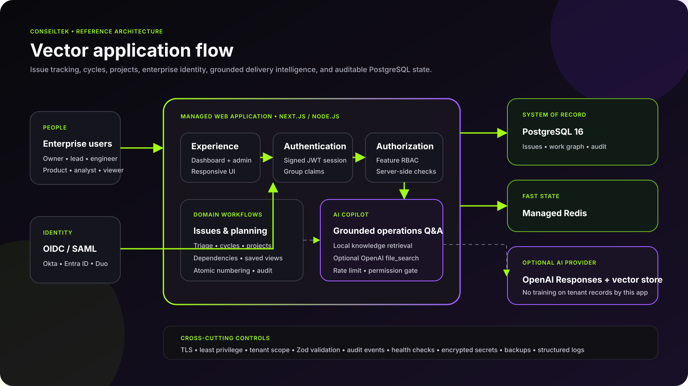
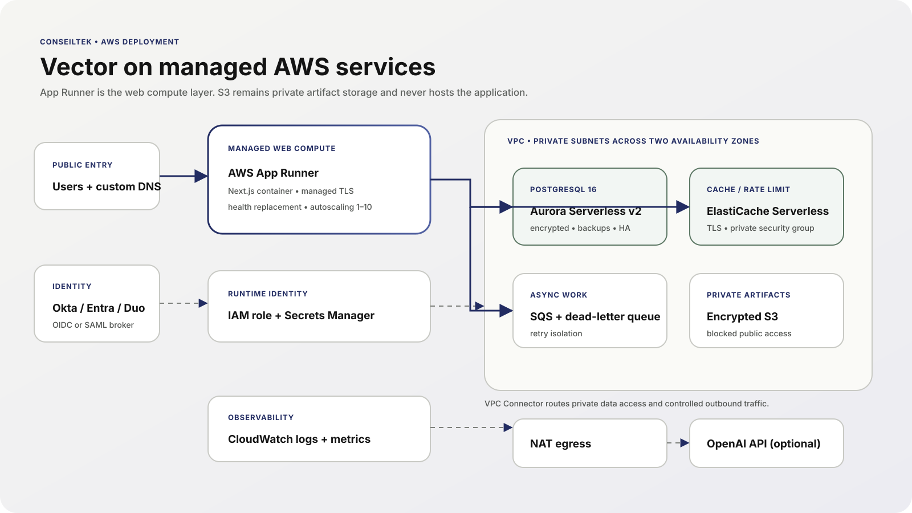
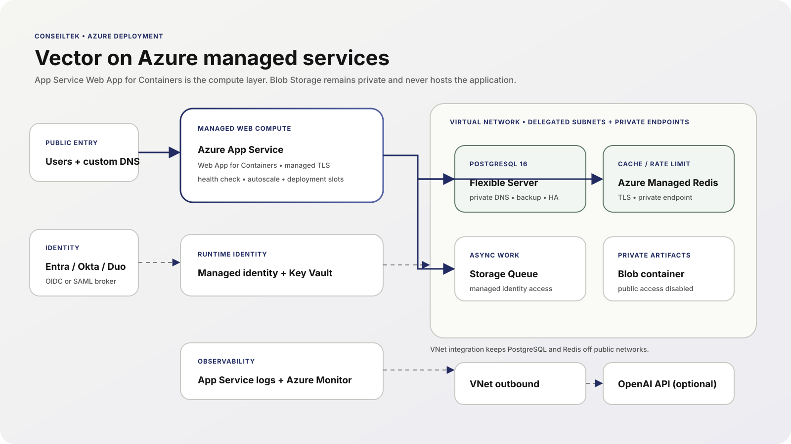

<div align="center">
  
  <h1>Vector</h1>
  <p><strong>Issue tracking that stays fast—and stays yours.</strong></p>
  <p>Cycles and projects · enterprise SSO · configurable RBAC · PostgreSQL · grounded AI · AWS and Azure</p>
</div>

[](https://github.com/ConseilTek-Tektons/vector/actions/workflows/ci.yml) [](https://github.com/ConseilTek-Tektons/vector/actions/workflows/codeql.yml) [](LICENSE)

Vector gives engineering teams one focused place to triage work, plan cycles, track project health, expose dependencies, and understand delivery risk. ConseilTek built it as a deployable application: the UI, authenticated APIs, PostgreSQL model, identity integration, tests, container, and two cloud deployment paths live together here.



## Working capabilities

- Issue, team, workflow, cycle, project, label, relationship, comment, attachment, saved-view, and audit models
- Atomic issue numbering and server-side `issues.manage` enforcement
- Configurable feature-level roles for owners, administrators, engineering leads, engineers, product partners, analysts, and viewers
- OIDC for Okta or Microsoft Entra ID; SAML providers including Duo connect through Keycloak or another OIDC broker
- Delivery copilot with cited local retrieval and optional OpenAI Responses API `file_search`; it has no mutation tools
- ConseilTek-branded responsive dashboard, working create interaction, access-policy editor, health endpoint, and demo personas
- Docker Compose development stack and production-ready AWS Terraform plus Azure Bicep

## Run locally

```bash
cp .env.example .env
docker compose up --build
```

Open [http://localhost:3000](http://localhost:3000). The included Keycloak realm runs on port 8080. For a UI-only tour, keep `AUTH_DEMO_MODE=true`; production automatically rejects demo mode unless explicitly overridden.

For manual development: `pnpm install`, `pnpm db:migrate`, `pnpm db:seed`, then `pnpm dev`.

## Managed cloud deployment

Vector needs authenticated server routes, PostgreSQL transactions, SSO callbacks, and AI orchestration, so static website hosting is not an appropriate runtime.

| Cloud | Managed web runtime | PostgreSQL | Cache | Deployment |
|---|---|---|---|---|
| AWS | AWS App Runner | Aurora PostgreSQL Serverless v2 | ElastiCache Serverless | [Terraform](infra/aws/README.md) |
| Azure | Azure App Service Web App for Containers | PostgreSQL Flexible Server | Azure Managed Redis | [Bicep](infra/azure/README.md) |

These services reduce application maintenance by managing compute replacement, TLS integration, scaling, database backups and patching, and cache operations. Private S3 or Blob storage holds attachments; it does not host the web application.





## Operate and extend

- [Architecture](docs/ARCHITECTURE.md) · [Authentication](docs/AUTHENTICATION.md) · [RBAC](docs/RBAC.md)
- [AI and RAG](docs/AI.md) · [Security](docs/SECURITY.md) · [Operations](docs/OPERATIONS.md)
- Quality gate: `pnpm check`, `terraform -chdir=infra/aws validate`, `bicep build infra/azure/main.bicep`, and `docker build -t vector:local .`

## Ownership

Vector is designed, built, and maintained by [ConseilTek](https://conseiltek.com) and licensed under Apache 2.0. ConseilTek trademarks and supplied brand artwork are not granted by the source-code license. Contact [support@conseiltek.com](mailto:support@conseiltek.com).
