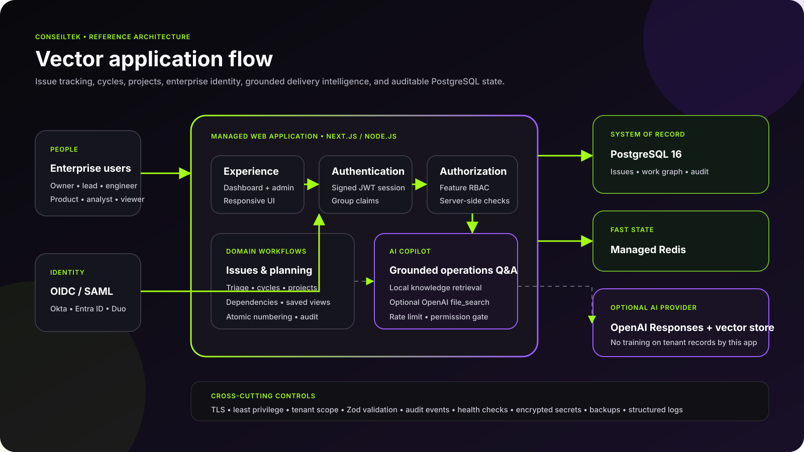

# Vector architecture

Vector is a modular monolith: one OCI container owns the browser experience, authenticated routes, feature authorization, issue transactions, and AI orchestration. PostgreSQL 16 is the durable system of record; Redis is optional acceleration for distributed rate limits.

## Request and data flow

1. AWS App Runner or Azure App Service terminates HTTPS and forwards to Next.js on port 3000.
2. NextAuth validates the enterprise OIDC session. Okta and Entra ID connect directly; SAML is brokered through Keycloak or an equivalent identity service.
3. IdP groups map to application roles. Every protected server route recalculates effective permissions, including tenant policy overrides stored in PostgreSQL.
4. Zod validates issue input. A transaction locks the team counter, allocates the next issue number, writes the issue, and appends the audit event.
5. PostgreSQL constraints protect team numbering, workflow states, relations, ownership, and tenant scope under concurrent writes.
6. AI questions pass `assistant.ask`, a distributed rate limit, retrieval from approved documents, and citation assembly. No mutation tool is exposed.

## Bounded modules

| Module | Owns |
|---|---|
| Work graph | teams, issues, parent/child and blocking relationships, labels |
| Planning | projects, cycles, estimates, due dates, saved views |
| Identity and policy | OIDC session, group mapping, feature grants, audit |
| Intelligence | local grounded retrieval, optional hosted vector search, delivery explanations |
| Platform | health, PostgreSQL, Redis, object storage, deployment configuration |

## Invariants

- Tenant scope is derived on the server; callers cannot select another organization.
- Issue numbers are allocated while the team row is locked and are unique within a team.
- Relationship constraints reject self-reference; all writes use parameterized SQL.
- PostgreSQL remains authoritative. Read replicas must satisfy read-your-writes before serving a just-modified issue.

Vector requires server-side execution. App Runner and App Service Web App for Containers reduce VM and orchestrator maintenance while keeping a portable container and managed PostgreSQL.
